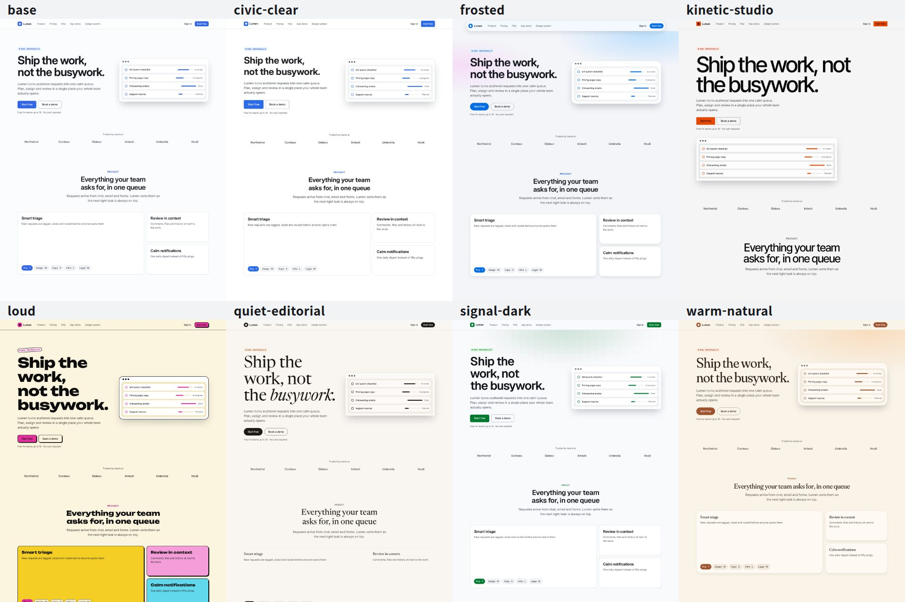
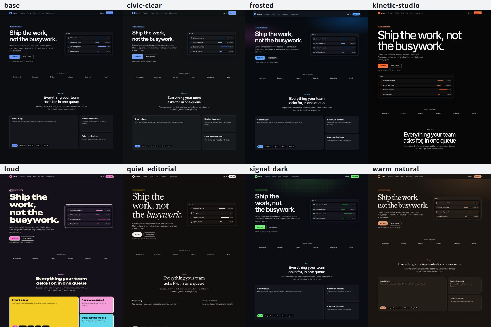
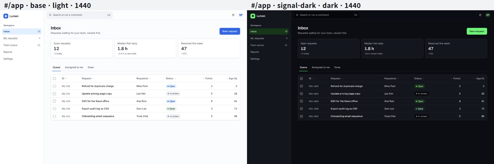
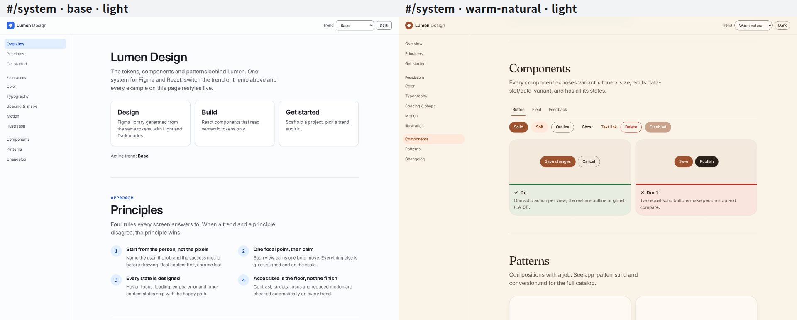
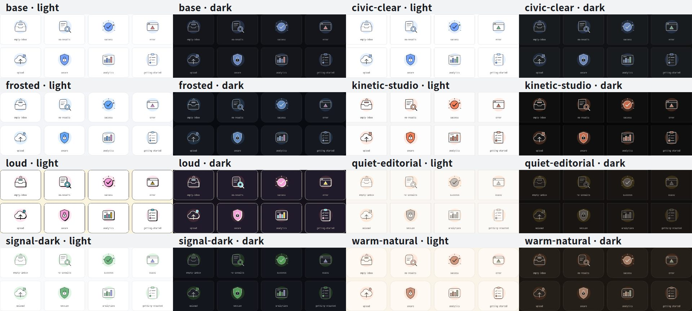

# web-design 스킬

**[English](README.md)**

Figma와 React 웹 프론트엔드를 **하나의 디자인 시스템**으로 묶어 설계하고 구현하는 Claude Code 스킬입니다. 두 개의 층으로 나뉩니다.

- **변하지 않는 원리**: 사람이 화면을 보고, 판단하고, 손으로 반응하는 방식입니다. 주의, 시선 흐름, 피츠의 법칙, 터치 도달 범위, 반응 시간, 모션 지각, 접근성을 다루며, 검사할 수 있는 규칙 약 75개로 정리했습니다.
- **몇 달마다 바뀌는 유행**: 날짜가 붙은 **트렌드 팩**으로 관리하고 갈아끼울 수 있습니다. 최신 스타일로 바꾸는 일은 코드 재작성이 아니라 `trend apply <id>` 한 줄입니다. Figma도 같은 방식으로 따라옵니다.



위 여덟 화면은 모두 같은 React 코드이고, 활성 트렌드 팩만 다릅니다. 모든 화면이 라이트·다크 모드와 320, 375, 768, 1440px에서 같은 감사를 MUST 0건으로 통과합니다. 감사는 휴먼 팩터, 느린 휴대폰에서의 성능, SEO를 함께 봅니다.

<details>
<summary>같은 여덟 화면의 다크 모드</summary>



</details>

템플릿에는 페이지가 세 개 있고, 감사 도구가 모든 트렌드에서 각각 검사합니다.

- **`/` 마케팅 페이지:** 히어로, 로고, 벤토 그리드, 수치, 후기, 요금제, FAQ, CTA
- **`#/app` 제품 UI:** 사이드바 셸, ⌘K 명령 팔레트, 정렬·일괄 작업·실행 취소를 지원하는 데이터 표, 다이얼로그, 메뉴, 툴팁, 토스트, 스켈레톤, 빈 상태 화면
- **`#/system` 살아있는 스타일 가이드:** 실시간 대비 배지가 붙은 파운데이션, 컴포넌트, Do/Don't 카드, 토큰으로 그린 일러스트







## Vite 또는 Next.js

`new-project.mjs`로 두 종류의 프로젝트를 만들 수 있습니다. 둘 다 `src/`의 같은 컴포넌트, 섹션, 화면을 씁니다.

| | Vite (기본) | Next.js 16 (`--framework next`) |
|---|---|---|
| 라우팅 | 해시 경로(`#/app`). 어떤 정적 호스팅에도 올라갑니다 | 실제 경로(`/app`)와 경로별 메타데이터 |
| 첫 화면 | 브라우저에서 렌더링 | 모든 경로를 HTML로 사전 렌더링 |
| 느린 4G에서 LCP | 2.1~2.6초 | 1.6초 |
| 첫 로드 JS | 101~143KB | 170~211KB |
| 글꼴 | head에서 스타일시트로 연결하고, 트렌드별 글꼴은 필요할 때 로드 | `next/font`로 자체 호스팅하고 메트릭을 맞춘 대체 글꼴 사용 |
| 배포 | `dist/`를 정적 호스팅에 | `next start`, 컨테이너, 또는 정적 export(`npm run build:static`) |

페이지가 각자 검색에 노출되어야 하거나 더 빨리 떠야 하면 Next.js를, 저사양 휴대폰의 첫 로드 JS가 가장 중요하면 Vite를 고르세요.

## 품질 게이트

모든 점검은 빌드나 감사 때마다 실행되며, 규칙은 `references/web-quality.md`에 정리되어 있습니다.

| 게이트 | 점검 내용 | 실행 시점 |
|---|---|---|
| `code-lint.mjs` (CL-01~13) | 원시 색상값, 기본 팔레트 클래스, 임의 px 값, 제거된 포커스 표시, 누르는 순간 실행되는 동작, 클릭 가능한 `div`, `alt`나 이미지 크기 누락, 확대 금지 | `npm run build` |
| `trend check` | 두 모드에서 본문 대비 4.5:1, 경계 대비 3:1, 모션 한도, 팩 스키마와 최신성 | CI |
| `audit.mjs` 휴먼 팩터 | `principles.md`의 규칙 약 75개(터치 영역, 행 길이, 포커스, 대비, 레이아웃, 모션)와 axe | `npm run audit` |
| `audit.mjs` 성능(PF) | 모바일 기준, 느린 4G와 CPU 4배 감속에서 LCP, CLS, TBT, 용량 예산, 이미지, 글꼴, 렌더링을 막는 스크립트 | `npm run audit` |
| `audit.mjs` SEO·공유(SE) | JS를 켠 상태와 끈 상태 모두에서 제목, 설명, canonical, Open Graph, 파비콘, JSON-LD, robots·sitemap, 크롤링 가능한 링크 | `npm run audit` |
| 시각 회귀(VR-01) | 저장한 기준 스크린샷과 픽셀 비교 | `--baseline save` / `compare` |
| 컴포넌트 테스트 | 실제 브라우저(Vitest 브라우저 모드)에서 키보드·포커스 동작과 axe | `npm test` |

## 구성

```
skills/web-design/
  SKILL.md                 워크플로: BRIEF → FOUNDATION → DESIGN(Figma) → BUILD(React) → QA → SYNC
  references/
    principles.md          시선 → 이해 → 결정 → 손 → 피드백 → 신뢰, 규칙 ID
    patterns.md            마케팅 섹션과 컴포넌트 목록
    app-patterns.md        제품 UI: 내비게이션, 표, 폼, 피드백, 검색, 설정, 대시보드, 오버레이
    conversion.md          랜딩·가격 페이지 근거, 커머스 페이지 구성안, 가입, 다크패턴 법규(한·EU·미)
    visual-craft.md        OKLCH 색 단계, 다크 모드, 타이포그래피, 레이아웃, 다층 그림자
    motion.md              모션 연출, 컴포넌트별 모션, 최신 CSS 지원 현황, 성능 예산, 모션 줄이기
    content.md             UX 문구 규칙 (영어·한국어)
    korean.md              한국어 우선·CJK 타이포그래피, 폼, KWCAG 2.2, 국내 관례
    review.md              디자인 리뷰 평가표(0–10)와 절차
    design-process.md      잘하는 디자이너의 작업 방식: 문제 정의, 탐색, 크리틱, 완료 기준
    figma-authoring.md     Figma 파일 구조, 오토 레이아웃, 컴포넌트, 변수, 핸드오프, 린트 규칙
    illustration.md        일러스트 역할, 토큰 기반 스타일 체계, 테마 대응, 접근성, IL 체크리스트
    trends.md              트렌드 팩 구조, 고르는 법, 분기별 갱신 절차
    tokens.md              토큰 계약 (DTCG → CSS 변수 → Tailwind v4 → Figma 변수)
    figma.md               공식 Figma MCP를 이용한 양방향 워크플로, Code Connect
    web-quality.md         성능 예산(PF), SEO와 공유(SE), 코드 린트(CL), 시각 회귀(VR)
  trends/<id>/             pack.json(메타데이터 + 토큰 덮어쓰기) + pack.css(시그니처 디테일)
  scripts/
    build-tokens.mjs       토큰과 팩을 tokens.css, fonts.json(Next는 next/font용 fonts.ts 추가), figma-variables.json으로 빌드
    trend.mjs              list | apply | add | new | check | radar (대비, APCA 권고, 모션, 재검토 기한)
    figma-sync.mjs         push(코드 → Figma 변수) | pull-script | pull(Figma → 코드 비교, --write로 반영)
    figma-library.mjs      Figma 시작용 라이브러리를 단계별로 생성(페이지, 스타일, 컴포넌트, 리뷰)
    figma-lint.mjs         Figma 페이지를 작성 규칙(L01–L30)에 맞춰 검사
    audit.mjs              휴먼 팩터 감사(Playwright + axe), 느린 4G 성능 측정, SEO와 공유 점검, 시각 회귀
    code-lint.mjs          디자인 규율 정적 린트(CL-01~CL-13), 빌드에 포함
    seo-files.mjs          사이트 주소로 robots.txt와 sitemap.xml 생성(Next 프로젝트)
    new-project.mjs        독립 실행 가능한 Vite 또는 Next.js 프로젝트 생성
  template/                Vite + React 19 + TypeScript + Tailwind v4 + Radix + cva + motion, Vitest 브라우저 테스트, Code Connect
  template-next/           Next.js 16 App Router 오버레이: 같은 src/, 실제 경로, next/font, 메타데이터, sitemap, robots
```

## 트렌드 팩 (2026-10 검토)

| 팩 | 단계 | 어울리는 곳 | 시그니처 |
|---|---|---|---|
| `quiet-editorial` | 상승 | 스튜디오, 럭셔리, 리서치, 긴 글 | 큰 세리프 헤드라인(마지막 단어 이탤릭), 박스 없는 카드, 알약형 버튼 |
| `signal-dark` | 상승 | 개발자 도구, AI 제품, 데이터 인프라 | 다크 우선, 서서히 사라지는 격자, 모노 라벨, 주 버튼 글로우 |
| `frosted` | 정점 | 소비자 앱, 미디어, 모바일 우선 | 떠 있는 유리 내비게이션 캡슐, 콘텐츠 카드는 불투명 유지 |
| `kinetic-studio` | 정점 | 런칭, 에이전시, 포트폴리오 | 포스터 크기 헤드라인이 단어별로 떠오름(한 번만, 500ms 이하, 모션 줄이기 설정 시 꺼짐) |
| `loud` | 상승 | 젊은 소비자, 식음료, 한정 드롭, 크리에이터 | 굵은 외곽선, 오프셋 그림자, 눌리는 버튼, 팝 컬러 타일 |
| `warm-natural` | 상승 | 웰니스, 숙박, 홈, 비영리 | 부드러운 세리프, 따뜻한 종이 톤, 둥근 형태, 느긋한 모션, 그레인 |
| `civic-clear` | 정점(상시) | 공공 서비스, 금융, 의료, 한국어 우선 서비스 | 본문 17px, 버튼 48px, 적당한 모서리, 높은 대비, 화면마다 파란 주요 버튼 하나 |

각 팩에는 수명 주기 단계(`stage`)와 재검토 기한(`reviewBy`)이 있습니다. 기한이 지나면 `trend list`가 **STALE**로 표시하므로, 낡은 팩이 모르는 새 계속 쓰이지 않고 최신 근거로 다시 검증됩니다. `trend radar`는 재검토가 필요한 팩과, 지난 검토 이후 Baseline 지원 상태가 바뀐 브라우저 기능을 보여줍니다. 갱신 절차는 `references/trends.md`에 있습니다.

## 설치

```bash
git clone https://github.com/jeonghun-app/web-design-skill.git
cd web-design-skill
./install.sh                      # skills/web-design을 ~/.claude/skills에 심볼릭 링크로 설치
cd skills/web-design/template && npm install && npx playwright install chromium
```

macOS와 Linux, Node 22 또는 24에서 동작합니다. Windows에서는 WSL을 쓰세요. 감사 스크립트가 미리보기 서버를 `npx`로 띄우고 POSIX 프로세스 그룹으로 종료하기 때문입니다.

Figma 작업을 하려면 공식 Figma MCP 서버를 Claude Code에 등록하고 `/mcp`로 인증하세요.

## 사용

Claude Code에 이렇게 요청하면 됩니다.

- "우리 예약 앱 랜딩 페이지를 요즘 스타일로 만들어줘"
- "이 Figma 프레임을 React로 구현해줘: <node-id가 포함된 링크>"
- "우리 토큰을 새 Figma 파일에 올리고 컴포넌트 라이브러리를 만들어줘"
- "사이트가 낡아 보여. 요즘 트렌드로 바꾸고 라이트/다크 스크린샷 보여줘"
- "요즘 웹디자인 트렌드가 뭐야? 트렌드 팩을 갱신해줘"

도구를 직접 실행할 수도 있습니다.

```bash
node skills/web-design/scripts/new-project.mjs ../my-site --install --trend signal-dark   # 한국어 사이트는 --lang ko 추가
# Next.js: ... ../my-site --framework next --site-url https://my-site.com --install
cd ../my-site
npm run dev                          # 오른쪽 아래 개발 패널에서 트렌드와 테마를 바로 전환
npm run trend -- list
npm run trend -- apply warm-natural  # 전체 스타일 교체
npm run audit -- --trends all        # 휴먼 팩터 + 성능 + SEO 감사, 결과는 design/audit/
npm test                             # 실제 브라우저에서 컴포넌트 테스트(키보드, 포커스, axe)
npm run figma-sync -- push > design/build/figma-push.js   # use_figma MCP 도구로 실행
```

## 트렌드 전환 원리

1. 컴포넌트는 의미 토큰만 읽습니다. 예: `bg-primary`, `rounded-card`, `text-display`, `surface`, `duration-(--motion-duration-small)`. Tailwind 기본 팔레트를 제거해서 색을 하드코딩하면 컴파일되지 않습니다.
2. 팩은 `[data-trend="<id>"]` 아래에서 토큰 일부를 라이트·다크 모드별로 덮어씁니다. 호버 상태나 연한 브랜드색 같은 파생 토큰은 상대 색 문법으로 계산되므로, 브랜드 색 하나만 바꾸면 됩니다.
3. 토큰으로 표현할 수 없는 부분은 범위가 제한된 작은 `pack.css`에 둡니다. 이를 위해 컴포넌트가 `data-slot`, `data-variant`, `data-tone` 속성을 제공합니다.
4. `trend check`는 어느 모드에서든 아래에 해당하면 팩을 실패 처리합니다.
   - 반투명 레이어를 합성한 결과, 텍스트 대비가 4.5:1 미만이거나 경계 대비가 3:1 미만인 경우
   - 지속 시간이 500ms를 넘는 경우
   - 반복 애니메이션에 모션 줄이기 대체가 없는 경우
5. Figma에서는 같은 이름의 변수 값만 덮어씁니다. 예를 들어 `color/primary`의 코드 문법은 `var(--color-primary)`입니다. 변수에 연결된 레이어 전체가 한 번에 바뀝니다.

## 라이선스

MIT. 템플릿은 MIT 라이선스 프로젝트(shadcn/ui, Radix)의 패턴을 참고했습니다. 유료 UI 키트나 분석한 사이트의 코드, 마크업, 문구, 에셋은 포함하지 않습니다.
